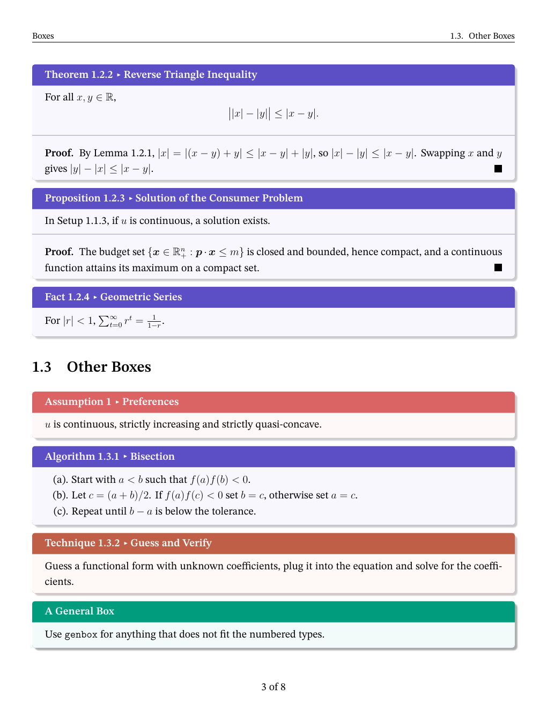

# tColNote

A lecture-notes template built on `tcolorbox` (`amznotes.cls`). It has a cover page, chapter banners, numbered and cross-referenced boxes (definitions, theorems, examples, ...) and an index that lists every box by type. `main.tex`, `ch1.tex` and `ch2.tex` are a demo of every feature. Copy them and replace the content to start your own notes.

<p align="center">
  
</p>

## Credits

This template is adapted from [**amznotes**](https://github.com/alexmingzhang/amznotes) by Alex Ming Zhang. I add the cover page, more types of boxes, math macros, etc. Many thanks to Alex for the amazing original template. 

## Building

### Overleaf

Upload all files in this folder to a new Overleaf project (or upload them as a zip). In **Menu → Settings**, set **Compiler** to **XeLaTeX**, then click **Recompile**. Overleaf runs Biber for the bibliography automatically and already has the fonts, Pygments and shell escape that the template needs.

### Local

Install [TeX Live](https://tug.org/texlive/) (full scheme) and, if you use the `code` option, Python with Pygments (`pip install Pygments`). Then run this in the project folder:

```bash
latexmk -xelatex -shell-escape main.tex
```

## Files

| File | Description |
| --- | --- |
| `amznotes.cls` | The template class |
| `main.tex` | Class options, cover page, chapter list, bibliography and index |
| `ch1.tex`, `ch2.tex` | Demo chapters (one file per chapter) |
| `ref.bib` | Bibliography entries |
| `attach/` | Images and code files used in the notes |
| `docs/preview.png` | Page 4 of the compiled demo, shown above (not needed to compile) |

## Quick reference

Class options (can be combined):

| Option | Effect |
| --- | --- |
| `math` | Theorem-like boxes, the `proof` environment and the math macros |
| `code` | Loads `minted`; enables `codebox`, `amzcode` and `\amzinputcode` |
| `fastcompile` | Drops chapter banners, headers and box styling for quicker drafts |

```latex
\documentclass[math,code]{amznotes}
\addbibresource{ref.bib}
\begin{document}
\coverpage{Course Name}{Notes by Your Name}{\today}
\tableofcontents
\input{ch1.tex}
\printbibliography
\amzindex
\end{document}
```

### Numbered boxes

```latex
\begin{defbox}{Title}{label} ... \end{defbox}   % numbered, e.g. Definition 1.1.1
\begin{defbox*}{Title} ... \end{defbox*}        % unnumbered
Definition \ref{def:label}                      % reference: <prefix>:<label>
```

All numbered boxes share one counter within each section and appear in the index (`\amzindex`).

| Box | Title | Prefix | Needs |
| --- | --- | --- | --- |
| `defbox` | Definition | `def` | |
| `stbox` | Setup | `st` | |
| `exbox` | Example | `ex` | |
| `agrbox` | Algorithm | `agr` | |
| `tecbox` | Technique | `tec` | |
| `asmpbox` | Assumption | `asmp` | own counter per section; not in the index |
| `lembox` | Lemma | `lem` | `math` |
| `thmbox` | Theorem | `thm` | `math` |
| `prpbox` | Proposition | `prp` | `math` |
| `fctbox` | Fact | `fct` | `math` |
| `solbox` | Optimization Solution | `sol` | `math` |
| `codebox` | Code Snippet | `code` | `code` |

To add a new box type, add a line like this to `amznotes.cls` next to the existing ones:

```latex
\newamzbox{rmkbox}{Remark}{rmk}{amznoteboxcolor}   % {environment}{title}{prefix}{color}
```

### Other commands

| Command / environment | Description |
| --- | --- |
| `\coverpage{title}{author}{date}` | Cover page; prints "author on date" under the title |
| `\amzindex` | Index of all numbered boxes, grouped by type |
| `\tcbline` | Separator inside a box, e.g. between a statement and its proof |
| `\deftxt{term}` | Newly defined term in bold italics |
| `genbox{title}` / `notebox` / `refbox` | General box / note box / reference box (not numbered) |
| `\mpic{file}[width][before][after]` | Image; width is a ratio of `\linewidth` (default `0.5`), spaces default to `0.5em` |
| `\begin{amzcode}{language}` | Code with line numbers (`code`) |
| `\amzinputcode{language}{file}` | Code from an external file (`code`) |
| `\cite{key}` / `\citep{key}` | "Author (Year)" / "(Author, Year)" |
| `\R \N \Z \Q \abs \norm \floor \ceil \rb \sqb \cb \restrict \pd \st \bs` | Math macros (`math`), see the end of `amznotes.cls` |